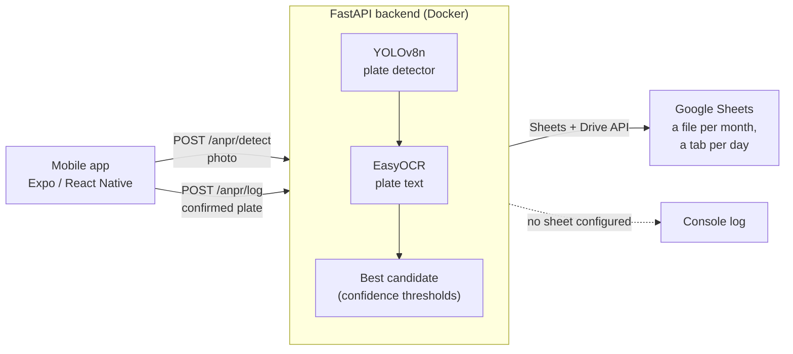

# FleetScan

*ANPR fleet-auditing app (repo: `anpr-fleet-tool`)*

**Snap a photo of a number plate on your phone, and the plate is read and written into the branch's yard-audit spreadsheet.**

A React Native app sends the photo to a FastAPI backend. The backend finds the plate with a custom-trained YOLOv8 detector, reads it with EasyOCR, and writes it into the REGO column of today's tab in the month's Google Sheet.

**Live demo API:** <https://anpr-backend-452959198599.us-central1.run.app/docs>. Upload a car photo to `POST /anpr/detect` from the docs page. It runs in demo mode, so logs go to the server console, not a Sheet. The first request after the service has been idle takes a few extra seconds while it cold-starts.

---

## Problem and outcome

At a car rental branch, keeping track of which vehicles are on the lot meant typing plates in by hand. That's slow, and typos make the records unreliable.

I built this tool on my own time to replace the manual step: point a phone at the plate, confirm the reading, and it's logged with a timestamp. A Europcar branch team of about **15 staff adopted it for daily use**.

---

## Architecture



1. The app shows a live camera view with a plate guide. The user lines up the plate and taps **Scan Plate** (or picks a photo from the library), and the photo goes to `POST /anpr/detect`.
2. YOLOv8 locates plate regions and EasyOCR reads each crop. The candidate with the highest OCR confidence that passes both thresholds (YOLO ≥ 0.35, OCR ≥ 0.45) is returned. If none passes, the response is `needs_rescan`.
3. The plate is highlighted on the frozen photo, with the rest tinted, and the reading is shown with a confidence label. The user checks it and taps **Confirm & Log**, which calls `POST /anpr/log`.
4. The backend writes the plate into the next empty REGO cell of today's tab (named `DD/MM/YYYY`, NZ time), unless it's already on that tab. The rest of the row is the spreadsheet's own formulas (model lookup, found-in-system check), so nothing else is touched. See [Google Sheets](#google-sheets) for the layout.

---

## Tech stack

| Layer | Technology |
|---|---|
| Mobile | React Native, Expo Router, TypeScript |
| API | FastAPI, Uvicorn, Python 3.11 |
| Detection | YOLOv8n (Ultralytics), fine-tuned on NZ plates |
| OCR | EasyOCR (pretrained English model) |
| Imaging | OpenCV, NumPy |
| Logging | Google Sheets API v4 |
| Packaging | Docker, Docker Compose |
| Hosting | Google Cloud Run (free tier) |
| Tests | pytest |

---

## Run it locally

### Backend: one command

```bash
docker compose up --build
```

The first build takes several minutes because it installs PyTorch and bakes in the OCR weights. Then:

- interactive API docs: <http://localhost:8000/docs>
- health check: `curl localhost:8000/health`, which returns `"pipeline_ready": true` once the model has loaded

**No credentials are needed.** With no spreadsheet configured, plates are printed to the container log instead. To log to a real spreadsheet, follow [Google Sheets](#google-sheets) and fill in `backend/anpr-server/.env` (from `.env.example`).

<details>
<summary>Without Docker</summary>

```bash
cd backend/anpr-server
python3.11 -m venv .venv && source .venv/bin/activate
pip install torch==2.15.0 torchvision==0.29.2 --index-url https://download.pytorch.org/whl/cpu
pip install -r requirements-dev.txt
uvicorn app:app --reload
```
</details>

### Tests

```bash
cd backend/anpr-server
pytest                          # API tests with a fake model, < 1 s
ANPR_INTEGRATION=1 pytest       # also loads the real YOLOv8 + EasyOCR pipeline
```

Every test image is generated at runtime, and no real plates are used.

### Mobile app

```bash
cd mobile
npm install
npx expo start
```

Scan the QR code with **Expo Go** (SDK 58). Expo Go now requires an Expo account, so sign in on your phone and run `npx expo login` on your computer, which opens a browser and also works for accounts created with GitHub. With no configuration, the app calls the backend on the same machine Expo is running on, port 8000, so a phone on the same Wi-Fi works with `docker compose up`. To use a deployed backend:

```bash
echo "EXPO_PUBLIC_API_URL=https://your-service.run.app" > mobile/.env
```

### Deploy (Google Cloud Run, free tier)

```bash
PROJECT_ID=your-project ./deploy/cloud-run.sh
```

Cloud Build builds the image, so no local Docker is needed. The script also gives the project's build service account the Cloud Run Builder role, which newer projects don't grant by default. The service scales to zero and is capped at one instance, so it stays within the free allowance. A warm scan takes about 3 s from New Zealand to `us-central1`, most of it CPU inference. The first request after the service has been idle also waits for the container to start and the model to load, and the app retries while the server warms up.

To log to the audit spreadsheet, add the variables from [Google Sheets](#google-sheets). The image (~1 GB) is larger than Artifact Registry's 0.5 GB free storage, so after Google's trial credit ends expect a few cents a month.

---

## Google Sheets

The app fills in the branch's existing physical-fleet report rather than a log of its own:

- **A spreadsheet per month,** all in one Drive folder. The newest one is in use. In the app, **Sheet → Start *month*** copies a template spreadsheet into the folder; starting a month that already has a file just switches to it.
- **A tab per day,** named `DD/MM/YYYY`. The first scan of the day copies the `TEMPLATE` tab (title, headers, colours, formulas, no regos) and puts the new tab first.
- **Plates go in the REGO column** (A6 down) and nowhere else. MODEL, FOUND and NOTES, and the system list on the right, belong to the sheet. A plate already on today's tab isn't added twice, undo clears just its cell, and if the template runs out of rows the row above is copied so the formulas carry on.

### Setup

1. **Template:** copy the current report, delete the date tabs, and add a tab called `TEMPLATE` with the layout and formulas but no regos. Keep any tab the MODEL formula looks up from.
2. **Folder:** make a Drive folder for the monthly files. The template can live anywhere.
3. **Sign-in:** the files live in a personal Drive, where a service account can't create files, so the backend acts as your Google account:
   - In Google Cloud Console (same project), create an OAuth client of type **Desktop app** and download its JSON. Set the consent screen's publishing status to **In production**; in *Testing*, Google expires the sign-in after 7 days.
   - Run the one-time sign-in. Google warns that the app is unverified, which is expected for your own client.
     ```bash
     pip install -r backend/anpr-server/requirements-dev.txt
     python backend/scripts/google_sign_in.py --client-secret ~/Downloads/client_secret_XXX.json
     ```
     This writes `backend/google-token.json` (git-ignored, and outside the folder uploaded to Cloud Run).
4. **Deploy** with the folder and template IDs (the long strings in their URLs):
   ```bash
   PROJECT_ID=your-project SHEETS_FOLDER_ID=... SHEETS_TEMPLATE_ID=... \
     SHEET_TITLE_PREFIX="Physical report" OAUTH_TOKEN_FILE=backend/google-token.json \
     ./deploy/cloud-run.sh
   ```
   The sign-in and an API key go into Secret Manager. Put the key in the app:
   ```bash
   echo "EXPO_PUBLIC_API_KEY=$(gcloud secrets versions access latest --secret fleetscan-api-key)" >> mobile/.env
   ```

Locally, set `SHEETS_FOLDER_ID`, `SHEETS_TEMPLATE_ID` and `GOOGLE_APPLICATION_CREDENTIALS=<path to google-token.json>` in `backend/anpr-server/.env`.

---

## How the model was trained

- **Data:** 26 phone photos of fleet vehicles. I annotated the plates in Roboflow (one class, `Number-Plates`) and used its augmentation to export 78 images. The photos show real plates, so they are **not** in this repo.
- **Training:** fine-tuned pretrained `yolov8n.pt` for 50 epochs at 640 px, batch 8, on CPU (Ultralytics defaults otherwise). The training curves and confusion matrix are in [`backend/runs/detect/train/`](backend/runs/detect/train/).
- **OCR:** EasyOCR's off-the-shelf English recogniser runs on each detected crop. Spaces and hyphens are stripped and the text is uppercased.
- **Honest caveat:** the dataset config pointed validation at the training images, so the reported mAP50 of 0.995 is *training* accuracy, not a held-out score. In spot checks, the detector's confidence was high (~0.9). The weaker step is OCR. I measured it on the 26 source photos, using the photo filenames as ground truth:
  - Plain EasyOCR got an exact match **7 times out of 26**. It confused characters (e.g. `Q` read as `@`) and could not read tilted plates at all.
  - Restricting OCR to the characters A–Z and 0–9, and straightening tilted plates before reading them, raised that to **17 out of 26**. To straighten a plate, the app finds the plate's bright rectangle in the crop, measures its tilt, and rotates the crop level. Steep tilts are read at the estimate and ±5°, and the most confident reading is kept.
  - OCR then keeps the **tallest line of text** in the crop, so dealer surrounds and slogan lines ("Enter a message") are ignored even when OCR is more confident about them. It also corrects a single `1`/`I` or `0`/`O` look-alike when that makes a standard NZ plate (`ABC123` or `AB1234`). Personalised plates are left alone.
  - In the app, the user confirms each reading before it is logged.

### Leak-free retraining

[`backend/training/train_detector.py`](backend/training/train_detector.py) retrains the detector without test-set leakage:

1. **Splits by original photo.** Every Roboflow copy of a photo stays on one side of every split, and the run stops if a photo group or an identical file appears on both sides.
2. **Holds out 20% of photos as a test set before anything else,** and saves the split to `split.json`.
3. **Runs grouped 5-fold cross-validation** on the remaining photos to choose the training configuration.
4. **Trains with `val=False` and keeps the last epoch,** so no evaluation set picks the weights. Ultralytics' usual `best.pt` would let its validation list leak into the model.
5. **Scores the result once** on the held-out photos. With `--refit-all`, it then retrains on every photo for deployment.

The first run used 26 photos: 21 for training and cross-validation, 5 held out.

| | Original settings | Rotation/perspective, no flips |
|---|---|---|
| CV mean mAP50 | 0.988 | 0.990 |
| CV mean mAP50-95 | **0.711** | 0.586 |

- **Held-out test** (the original settings, chosen by CV): **mAP50 0.995, mAP50-95 0.65, recall 1.0**. This is the first score from photos the model never trained on.
- **End to end on the held-out photos,** the retrained detector read 4/5 plates exactly. That is the same as the production model, which had seen those photos, so the retrained weights were **not deployed**.
- **The detector is limited by data, not settings.** The next gain needs more varied photos (black plates, slogans, surrounds, angles, night), and this script retrains on them in one command.

---

## Limitations

- **Small dataset:** 26 vehicles, so the held-out test set is only 5 photos, and the detector misses unusual plates (black, slogan) it has never seen.
- **OCR character confusions:** only single `1`/`I` and `0`/`O` slips on standard-format plates are corrected; others (e.g. `B`/`8`) still need the user to rescan.
- **One API key, shipped in the app:** it keeps strangers who find the URL away from the logging endpoints, but anyone who unpacks the app can read it. `/anpr/detect` stays open for the demo.
- **The backend acts as one person's Google account,** so the spreadsheets belong to that account. A company setup would use a Shared Drive and a service account instead.
- **One instance only:** a lock in the server stops two scans claiming the same empty cell, which relies on Cloud Run's one-instance cap.
- **Errors use HTTP 200** with a `status` field rather than HTTP status codes.
- **CPU-only inference** on a ~1 GB image, so cold starts are slow.

## What I'd do next

1. Collect more varied photos (black plates, slogans, angles, weather, night) and rerun the leak-free retraining. Rotation augmentation scored worse in cross-validation on the current data, so it should be re-tested once there is more.
2. Export YOLO to ONNX and use a lighter OCR to shrink the image, cutting memory and cold starts and fitting smaller free tiers.
3. Look up make, model and colour from the plate (CarJam), per-user sign-in instead of a shared key, and proper HTTP status codes.
4. Add CI (GitHub Actions) to run the tests and build the image on every push.

---

## Repository layout

```
backend/anpr-server/
  app.py              FastAPI app: endpoints, model loading, best-candidate selection
  ocr.py              ANPRPipeline: YOLOv8 detection + EasyOCR reading
  sheets.py           the audit spreadsheet: month files, day tabs, REGO column, undo
  models/detector/    best.pt, the trained detector (6 MB)
  tests/              pytest suite
backend/runs/detect/train/   training curves and metrics
backend/scripts/             Google sign-in for the backend; a dev inference script
mobile/                      Expo app (scanner screen: app/(tabs)/index.tsx)
deploy/                      Cloud Run deploy script
docker-compose.yml
```

More detail: [backend](backend/backendREADME.md) · [mobile](mobile/mobileREADME.md)
