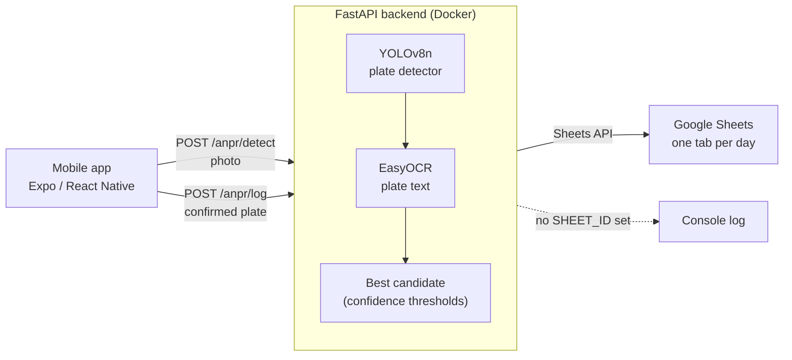

# ANPR Fleet Tool

**Snap a photo of a number plate on your phone, and the plate is read and logged to a shared Google Sheet.**

A React Native app sends the photo to a FastAPI backend. The backend finds the plate with a custom-trained YOLOv8 detector, reads it with EasyOCR, and appends it to a Google Sheet tab for the day.

---

## Problem and outcome

At a car rental branch, keeping track of which vehicles are on the lot meant typing plates in by hand. That's slow, and typos make the records unreliable.

I built this tool on my own time to replace the manual step: point a phone at the plate, confirm the reading, and it's logged with a timestamp. A Europcar branch team of about **15 staff adopted it for daily use**.

---

## Architecture



1. The user taps **Scan Plate**, the camera opens, and the photo goes to `POST /anpr/detect`.
2. YOLOv8 locates plate regions and EasyOCR reads each crop. The candidate with the highest OCR confidence that passes both thresholds (YOLO ≥ 0.35, OCR ≥ 0.45) is returned. If none passes, the response is `needs_rescan`.
3. The user checks the reading and taps **Confirm & Log**, which calls `POST /anpr/log`.
4. The backend ignores repeat scans of the same plate within 15 s, then appends `[timestamp, plate, yolo_conf, ocr_conf, source]` to today's tab (NZ time).

---

## Tech stack

| Layer | Technology |
|---|---|
| Mobile | React Native, Expo Router, TypeScript |
| API | FastAPI, Uvicorn, Python 3.11 |
| Detection | YOLOv8n (Ultralytics), fine-tuned on NZ plates |
| OCR | EasyOCR (pretrained English model) |
| Imaging | OpenCV, NumPy |
| Logging | Google Sheets API v4 |
| Packaging | Docker, Docker Compose |
| Hosting | Google Cloud Run (free tier) |
| Tests | pytest |

---

## Run it locally

### Backend: one command

```bash
docker compose up --build
```

The first build takes several minutes because it installs PyTorch and bakes in the OCR weights. Then:

- interactive API docs: <http://localhost:8000/docs>
- health check: `curl localhost:8000/health`, which returns `"pipeline_ready": true` once the model has loaded

**No credentials are needed.** Without a `SHEET_ID`, plates are printed to the container log instead of written to a Sheet. To log to a real Sheet, copy `backend/anpr-server/.env.example` to `.env` and fill it in.

<details>
<summary>Without Docker</summary>

```bash
cd backend/anpr-server
python3.11 -m venv .venv && source .venv/bin/activate
pip install torch==2.15.0 torchvision==0.29.2 --index-url https://download.pytorch.org/whl/cpu
pip install -r requirements-dev.txt
uvicorn app:app --reload
```
</details>

### Tests

```bash
cd backend/anpr-server
pytest                          # API tests with a fake model, < 1 s
ANPR_INTEGRATION=1 pytest       # also loads the real YOLOv8 + EasyOCR pipeline
```

Every test image is generated at runtime, and no real plates are used.

### Mobile app

```bash
cd mobile
npm install
npx expo start
```

Scan the QR code with **Expo Go**. With no configuration, the app calls the backend on the same machine Expo is running on, port 8000, so a phone on the same Wi-Fi works with `docker compose up`. To use a deployed backend:

```bash
echo "EXPO_PUBLIC_API_URL=https://your-service.run.app" > mobile/.env
```

### Deploy (Google Cloud Run, free tier)

```bash
PROJECT_ID=your-project ./deploy/cloud-run.sh
```

Cloud Build builds the image, so no local Docker is needed. The service scales to zero and is capped at one instance, so it stays within the free allowance. The first request after it has been idle takes about 30 s to cold-start, and the app retries while the server warms up.

Add `SHEET_ID=...` to log to a Sheet. The service then runs as its own service account: you share the Sheet with that account's email, and no key file exists anywhere. The image (~1 GB) is larger than Artifact Registry's 0.5 GB free storage, so after Google's trial credit ends expect a few cents a month.

---

## How the model was trained

- **Data:** 26 phone photos of fleet vehicles. I annotated the plates in Roboflow (one class, `Number-Plates`) and used its augmentation to export 78 images. The photos show real plates, so they are **not** in this repo.
- **Training:** fine-tuned pretrained `yolov8n.pt` for 50 epochs at 640 px, batch 8, on CPU (Ultralytics defaults otherwise). The training curves and confusion matrix are in [`backend/runs/detect/train/`](backend/runs/detect/train/).
- **OCR:** EasyOCR's off-the-shelf English recogniser runs on each detected crop. Spaces and hyphens are stripped and the text is uppercased.
- **Honest caveat:** the dataset config pointed validation at the training images, so the reported mAP50 of 0.995 is *training* accuracy, not a held-out score. In spot checks, the detector's confidence was high (~0.9). The weaker step is OCR. With plates read off the 26 source photos and the photo filenames as ground truth, EasyOCR's top reading was an exact match **7 times out of 26**. The usual errors are character confusions such as reading `Q` as `@`. In the app, the user confirms each reading before it is logged.

---

## Limitations

- **No held-out evaluation:** the dataset is small (26 vehicles) and has no separate validation or test split.
- **OCR character confusions:** there is no NZ plate-format check (e.g. `ABC123`) to catch or correct misreads.
- **Deduplication is per instance and in memory:** it resets on restart. It also records a plate *before* the Sheets write, so a failed write that's retried within 15 s is reported as a duplicate.
- **No authentication on the API:** anyone who knows the URL can call `/anpr/log`. The public demo therefore runs without a Sheet.
- **Errors use HTTP 200** with a `status` field rather than HTTP status codes.
- **CPU-only inference** on a ~1 GB image, so cold starts are slow.

## What I'd do next

1. Collect more varied data (weather, angles, night), add a proper train/val/test split, and report real held-out metrics.
2. Validate and correct OCR output against NZ plate formats.
3. Export YOLO to ONNX and use a lighter OCR to shrink the image, cutting memory and cold starts and fitting smaller free tiers.
4. Add an API key on logging endpoints, proper HTTP status codes, and a real datastore with history and search.
5. Add CI (GitHub Actions) to run the tests and build the image on every push.

---

## Repository layout

```
backend/anpr-server/
  app.py              FastAPI app: endpoints, model loading, best-candidate selection
  ocr.py              ANPRPipeline: YOLOv8 detection + EasyOCR reading
  sheets.py           Google Sheets logging (or console), dedup, credentials
  models/detector/    best.pt, the trained detector (6 MB)
  tests/              pytest suite
backend/runs/detect/train/   training curves and metrics
backend/scripts/             one-off inference script used during development
mobile/                      Expo app (scanner screen: app/(tabs)/index.tsx)
deploy/                      Cloud Run deploy script
docker-compose.yml
```

More detail: [backend](backend/backendREADME.md) · [mobile](mobile/mobileREADME.md)
